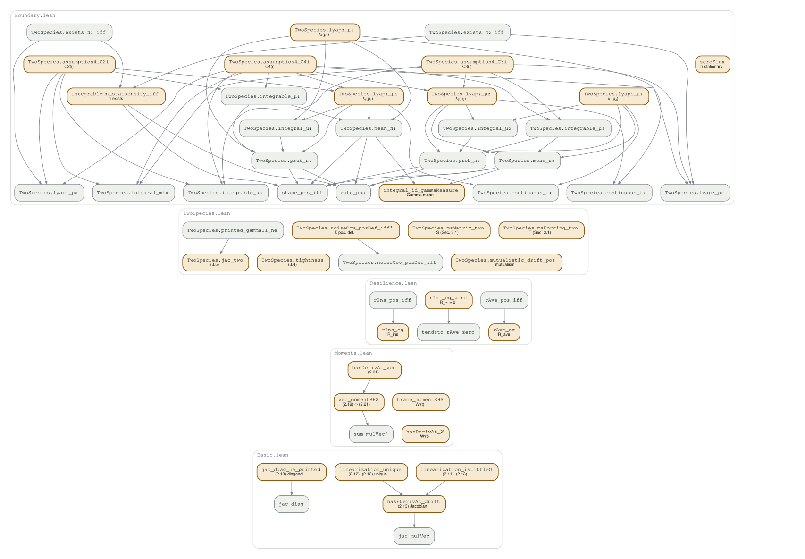

# Lean 4 formalization: resilience of a stochastic generalized Lotka–Volterra model

[](https://doi.org/10.3934/mbe.2025056)
[](https://doi.org/10.5281/zenodo.24293110)
[](https://github.com/magbenji/sglv-resilience-lean/actions/workflows/lean_action_ci.yml)

Machine-checked proofs (Lean 4 + Mathlib) of the mathematics in the paper
*Resilience of a stochastic generalized Lotka–Volterra model for microbiome studies* by
T. A. Phan, B. J. Ridenhour and C. H. Remien, Mathematical Biosciences and Engineering
22(6):1517–1550, 2025 ([doi:10.3934/mbe.2025056](https://doi.org/10.3934/mbe.2025056)).
Section, equation and case numbers below refer to that paper. Every theorem below compiles with
no `sorry` and depends only on Lean's three standard axioms (`propext`, `Classical.choice`,
`Quot.sound`).

Companion formalizations:
[continuous-modified-gradient-lean](https://github.com/magbenji/continuous-modified-gradient-lean)
and [discrete-modified-gradient-lean](https://github.com/magbenji/discrete-modified-gradient-lean).

## What is formalized

The paper combines results it derives itself with persistence and extinction theorems for SDEs
that it cites without proof (Theorems 2.1–2.5, from Hening and Nguyen). Mathlib has Brownian
motion but no stochastic integral, Itô formula or SDE theory, so those cited theorems, and the
Itô-calculus steps that lead to (2.19) and to the Lyapunov-exponent formula, are **not**
formalized. Everything the paper computes or proves from them is:

| Paper | Lean name | File |
|---|---|---|
| (2.12)–(2.13): the drift `h` and its Jacobian | `drift`, `jac`, `hasFDerivAt_drift`, `jac_diag` | `SgLVResilience/Basic.lean` |
| (2.11): the linearization error is `o(‖X - m‖)` | `linearization_isLittleO` | `Basic.lean` |
| (2.11)–(2.13): those are the only such coefficients | `linearization_unique` | `Basic.lean` |
| (2.19) ⇔ (2.21): `vec` of (2.19) is `S Z + T` | `vec_momentRHS`, `hasDerivAt_vec` | `SgLVResilience/Moments.lean` |
| `W'(t)` (Section 2.4) | `trace_momentRHS`, `hasDerivAt_W` | `Moments.lean` |
| The four resilience measures | `rIns`, `rAve`, `rC`, `rInf` | `SgLVResilience/Resilience.lean` |
| `ℛᵗ_ins = -W'/(2W)`, `ℛᵗ_ave = -(1/2t) ln(W(t)/W(0))`, signs | `rIns_eq`, `rAve_eq`, `rIns_pos_iff`, `rAve_pos_iff` | `Resilience.lean` |
| `ℛ_∞ = 0` when `W(t)` has a positive limit | `rInf_eq_zero` | `Resilience.lean` |
| Section 3.1: `Σ` positive definite iff the three conditions | `TwoSpecies.noiseCov_posDef_iff'` | `SgLVResilience/TwoSpecies.lean` |
| (3.5): `Φᵢ`, `γᵢⱼ` | `TwoSpecies.jac_two` | `TwoSpecies.lean` |
| Section 3.1: the matrices `S` and `T` | `TwoSpecies.msMatrix_two`, `TwoSpecies.msForcing_two` | `TwoSpecies.lean` |
| (3.4) (Assumption 3), competitive and predator–prey cases | `TwoSpecies.tightness`, `TwoSpecies.exists_weights_predPrey` | `TwoSpecies.lean` |
| Mutualistic case: the drift identity | `TwoSpecies.mutualistic_identity`, `TwoSpecies.mutualistic_drift_pos` | `TwoSpecies.lean` |
| Cases 2–3: stationary density of the logistic SDE | `zeroFlux` | `SgLVResilience/Boundary.lean` |
| Cases 2–3: `πᵢ` exists iff `αᵢ - σᵢᵢ/2 > 0` | `integrableOn_statDensity_iff`, `TwoSpecies.exists_π₁_iff` | `Boundary.lean` |
| Mean of `πᵢ` | `integral_id_gammaMeasure`, `TwoSpecies.mean_π₁` | `Boundary.lean` |
| `λ₁(μ₀)`, `λ₂(μ₀)`, `λ₁(μ₁) = 0`, `λ₂(μ₁)`, `λ₁(μ₂)`, `λ₂(μ₂) = 0` | `TwoSpecies.lyap₁_μ₀`, ..., `TwoSpecies.lyap₂_μ₂` | `Boundary.lean` |
| C2(i), C3(i), C4(i): Assumption 4 holds | `TwoSpecies.assumption4_C2i`, `..._C3i`, `..._C4i` | `Boundary.lean` |

In C1–C4 the paper then applies Theorems 2.3–2.5. Those conclusions (convergence in total
variation, extinction rates, occupation measures) rest on the cited SDE theory and are not
formalized; what is checked is that the hypotheses the paper verifies for them hold.

## Corrections found

Formalizing the computations, and re-running them numerically
(`python3 scripts/check_tables.py`), turned up the following.

* **(2.13), diagonal.** `∂hᵢ/∂xᵢ(m) = αᵢ + ∑ₖ βᵢₖ mₖ + βᵢᵢ mᵢ`. The printed formula omits
  `βᵢᵢ mᵢ` (`jac_diag`, `jac_diag_ne_printed`).
* **(3.5), signs.** `γ₁₁ = α₁ - 2β₁₁m₁ + β₁₂m₂` and `γ₂₂ = α₂ + β₂₁m₁ - 2β₂₂m₂`; the paper prints
  `+2β₁₁m₁` and `+2β₂₂m₂` (`TwoSpecies.jac_two`, `TwoSpecies.printed_gamma11_ne`). Table 1 was
  computed with the correct signs.
* **(2.15)–(2.16).** The matrix `A` is printed with `γᵢⱼ` transposed (first row `γ₁₁ … γ_N1`);
  Section 3 uses `A = (γᵢⱼ)`, which is what `dỸᵢ = [Φᵢ + ∑ⱼ γᵢⱼ(Ỹⱼ - mⱼ)]dt + …` gives.
* **`T` in Section 3.1.** The first terms are `2Φ₁M₁`, `Φ₂M₁ + Φ₁M₂`, `2Φ₂M₂` (with `M = 𝔼Y`, from
  `vec(ΘMᵀ + MΘᵀ)`); the paper prints them with `m` (`TwoSpecies.msForcing_two`).
* **`π₁`.** Its scale is `(τ₁₁² + τ₁₂²)/(2β₁₁)`; the paper prints `(τ₂₁² + τ₂₂²)/(2β₁₁)`. The mean
  that gives the paper's (correct) `λ₂(μ₁)` is `(α₁ - σ₁₁/2)/β₁₁` (`TwoSpecies.mean_π₁`).
* **(3.4).** It writes `f₁ = X₁(α₁ - β₁₁X₁ + β₁₂X₂)` (the drift); condition (2.5), which (3.4)
  instantiates, uses the per-capita rates `f₁ = α₁ - β₁₁X₁ + β₁₂X₂`. `TwoSpecies.tightness` uses
  the per-capita rates.
* **Parameter values.** Table 1 is reproduced to rounding from its own `m₁, m₂` with
  `β₂₂ = 4/150 ≈ 0.02667` (Figure 3 prints `0.027`) and, in Set 4, `β₁₂ = -0.015` (the caption
  prints `-0.03`; the text says Set 4 halves `β₁₂`, as in Set 3). With these values the `ℛ_c` of
  Table 2 are reproduced exactly.
* **`ℛ_∞`.** With noise, `W(t)` does not decay to 0: in all four parameter sets the second
  moment of the linearized system converges to a positive stationary value (`W(4000) ≈ 1.3, 33,
  1.2, 29`), and whenever `W(t) → W∞ > 0` we have `ℛ_∞ = lim ℛᵗ_ave = 0` (`rInf_eq_zero`). The values
  `0.0047, 0.0031, 0.0048, 0.0032` in Table 2 are values of `ℛᵗ_ave` at a finite time `t`; for
  example `ℛᵗ_ave` is `0.0275, 0.0028, 0.0007` at `t = 100, 1000, 4000` for Set 1. So the gap
  `ℛ_c - ℛ_∞` equals `ℛ_c` whenever there is noise.

## Dependency graph

An arrow from A to B means the proof of A cites B. The paper's results are highlighted, and
boxes are grouped by file. Definitions, Mathlib lemmas, and helper lemmas that neither use nor are
used by another lemma are left out of the picture.
The [interactive version](https://magbenji.github.io/sglv-resilience-lean/) lets you click a
declaration to trace what it depends on and what depends on it, optionally shows the definitions
too, and lists every declaration with links to its source line.

<picture>
  <source media="(prefers-color-scheme: dark)" srcset="docs/dependency-graph-dark.svg">
  
</picture>

Unlike the two stability formalizations, most results here are independent computations. The
Lyapunov exponents of `μ₁, μ₂` go through the Gamma mean `integral_id_gammaMeasure`, and the
three Assumption-4 checks go through those exponents and the mixture formula `integral_mix`.

Both versions are generated from the source by `python3 scripts/dependency_graph.py`
(requires Graphviz). It writes the static images and their Graphviz source
(`docs/dependency-graph.dot`) and the interactive page `docs/index.html`, which GitHub Pages
serves from the `docs/` folder.

## How the paper's objects are encoded

* **States and parameters.** `x : Fin N → ℝ`, `α : Fin N → ℝ`, `β : Matrix (Fin N) (Fin N) ℝ`;
  `percap α β x i = fᵢ(x)` and `drift α β x i = hᵢ(x) = xᵢ fᵢ(x)`. The two-species model (3.1) is
  the structure `TwoSpecies` (with `β₁₁, β₂₂ > 0`), mapped to the general model by
  `TwoSpecies.alpha` and `TwoSpecies.beta = [[-β₁₁, β₁₂], [β₂₁, -β₂₂]]`.
* **Linearization.** `jac α β m` is the matrix `(∂hᵢ/∂xⱼ(m))`; (2.12)–(2.13) are `Φ = h(m)`,
  `γ = jac α β m`.
* **Moments.** (2.19) is the hypothesis `HasDerivAt P (momentRHS A B Θ m (M t) (P t)) t`, with
  `momentRHS` its right-hand side. `vec` is Mathlib's column-stacking `Matrix.vec`, and `⊗ₖ` is the
  Kronecker product, so `msMatrix A B = I ⊗ A + A ⊗ I + ∑ᵢ Bᵢ ⊗ Bᵢ` is the paper's `S` and
  `msForcing` its `T`. The `Bᵢ` are assumed symmetric (the paper's are diagonal).
* **Resilience.** `rIns W t`, `rAve W t`, `rC S = -α(S)/2` (with `α(S)` the largest real part of a
  complex eigenvalue, `spectralAbscissa`) and `rInf W = lim ℛᵗ_ave` (`limUnder`).
* **Boundary measures.** `TwoSpecies.μ₀ = δ_(0,0)`, `μ₁ = π₁ × δ₀`, `μ₂ = δ₀ × π₂`, with `πᵢ`
  Mathlib's `gammaMeasure (shape αᵢ σᵢᵢ) (rate βᵢᵢ σᵢᵢ)`: shape `2αᵢ/σᵢᵢ - 1`, rate
  `2βᵢᵢ/σᵢᵢ` (the paper's Gamma is parametrized by shape and scale = 1/rate). Lyapunov
  exponents are `lyapᵢ μ = ∫ fᵢ dμ - σᵢᵢ/2`. A convex combination `∑ qⱼ μⱼ` is
  `∑ ENNReal.ofReal qⱼ • μⱼ`.
* **Stationary density.** "`πᵢ` is the stationary law" is encoded as: `x^{k-1} e^{-rx}` solves the
  zero-flux Fokker–Planck equation `(σ/2 · x² p)' = x(α - βx) p` (`zeroFlux`), it is
  normalizable iff `α - σ/2 > 0` (`integrableOn_statDensity_iff`), and normalized it is the Gamma
  pdf (`gammaPDFReal_eq`). That the SDE has no other invariant law is part of the cited theory.

## Checking that it compiles

You need `elan`, the Lean version manager. Install it once on macOS or Linux with:

```bash
curl https://elan.lean-lang.org/elan-init.sh -sSf | sh
```

Then restart the terminal. Alternatively, install the **Lean 4** extension in VS Code, which
offers to install elan for you.

Clone the repository and build:

```bash
git clone https://github.com/magbenji/sglv-resilience-lean.git
cd sglv-resilience-lean
lake exe cache get            # downloads prebuilt Mathlib (a few GB, a few minutes)
lake build                    # compiles the five files
```

On macOS, if `lake exe cache get` fails with `Too many open files (os error 24)`, raise the limit
in that terminal first with `ulimit -n 10240`.

`lake build` should end with `Build completed successfully`. Lean prints
`declaration uses 'sorry'` for any unfinished proof, and there are none.

To list the axioms each main theorem relies on, run:

```bash
lake env lean Axioms.lean
```

Each line should read `depends on axioms: [propext, Classical.choice, Quot.sound]`.

The first `lake` command downloads the exact Lean version pinned in `lean-toolchain`
(`v4.35.0`) and the Mathlib commit pinned in `lake-manifest.json` (the same pins as the two
stability projects). If you skip `lake exe cache get`, `lake build` compiles about 3,000 Mathlib
files from source, which takes an hour or more.

The numerical checks need Python 3 with `numpy` and `scipy`:

```bash
python3 scripts/check_tables.py
```

To read the proofs interactively, open this folder in VS Code with the Lean 4 extension. Then
click inside any proof to see the goal state.

The GitHub Actions workflow in `.github/workflows/` runs the same build and axiom check on every
push; the badge at the top shows its latest result.

## Citation and license

If you use this code, please cite the paper (see `CITATION.cff`):

> T. A. Phan, B. J. Ridenhour and C. H. Remien, Resilience of a stochastic generalized
> Lotka–Volterra model for microbiome studies, Mathematical Biosciences and Engineering 22(6)
> (2025), 1517–1550. https://doi.org/10.3934/mbe.2025056

To cite the code itself, use the Zenodo archive: https://doi.org/10.5281/zenodo.24293110.

The code is released under the
Apache License 2.0 (see `LICENSE`), the same license as Mathlib.
